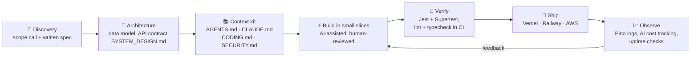
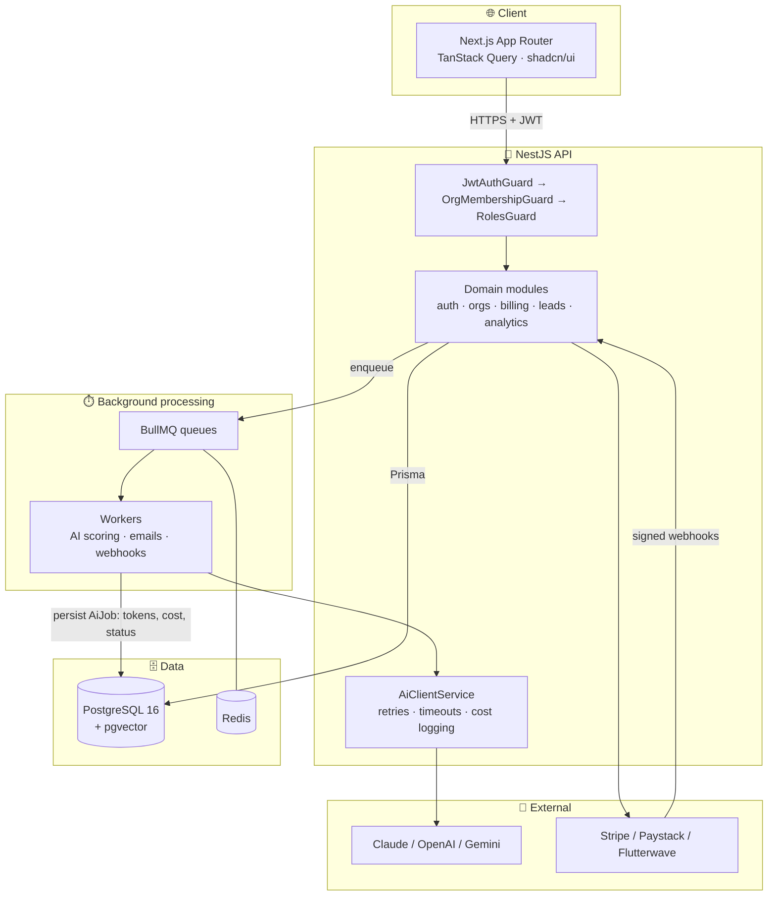

<!--
  ╔══════════════════════════════════════════════════════════════════════════╗
  ║  GitHub Profile README — Tim Emmanuel (emperor1234)                      ║
  ║                                                                          ║
  ║  Maintenance notes for whoever edits this file next:                     ║
  ║  • GITHUB_USERNAME is "emperor1234". If the account name changes,        ║
  ║    find-and-replace every occurrence (stats, streak, snake, views).      ║
  ║  • The contribution snake is generated by .github/workflows/snake.yml    ║
  ║    and published to the `output` branch. It appears after the first run. ║
  ║  • Broken links are caught weekly by .github/workflows/link-check.yml.   ║
  ║  • Section anchors use explicit <a id> tags so the nav never breaks,     ║
  ║    even if heading text or emoji change.                                 ║
  ║  • Keep claims verifiable: every project and credential below is real.   ║
  ╚══════════════════════════════════════════════════════════════════════════╝
-->

<!-- ─────────────────────────────── HEADER ─────────────────────────────── -->
<p align="center">
  
</p>

<p align="center">
  <a href="#about">
    
  </a>
</p>

<p align="center">
  <a href="https://www.upwork.com/freelancers/~01aa70875d078212d1"></a>
  
  
  
</p>

<!-- ───────────────────────────── QUICK NAV ────────────────────────────── -->
<p align="center">
  <a href="#about"><b>About</b></a> •
  <a href="#services"><b>What I Do</b></a> •
  <a href="#stack"><b>Tech Stack</b></a> •
  <a href="#engineering"><b>How I Engineer</b></a> •
  <a href="#projects"><b>Featured Work</b></a> •
  <a href="#experience"><b>Experience</b></a> •
  <a href="#credentials"><b>Credentials</b></a> •
  <a href="#stats"><b>GitHub Stats</b></a> •
  <a href="#contact"><b>Contact</b></a>
</p>

---

<!-- ─────────────────────────────── ABOUT ──────────────────────────────── -->
<a id="about"></a>

## 👨‍💻 About Me

I'm **Tim Emmanuel** (Timilehin), a **Senior Full-Stack Engineer** and **ML researcher** based in Lagos, Nigeria, and the founder of **EmperorXpert Digital Agency**.

I build software that has to survive real users: multi-tenant SaaS platforms, payment flows, background job pipelines, and AI features that are rate-limited, cost-tracked and observable instead of a raw API call inside a route handler. A large part of my recent work is **rescuing AI-built apps** (Lovable, Bolt, Cursor, Replit, Base44) and turning them into maintainable products with proper auth, row-level security, tests and CI/CD.

I work **spec-first**. Before any code, I write the architecture, data model, coding standards and an agent context kit (`AGENTS.md`, `CLAUDE.md`, `SYSTEM_DESIGN.md`, `SECURITY.md`) so that every contributor, human or AI, builds to the same rules. I use Claude Code daily, and I review every line it writes the way a senior engineer reviews a pull request.

My background in **psychology** (University of Ibadan) shapes how I design products: I think about how people actually perceive, decide and get stuck, not just how the system is wired.

```ts
/**
 * A typed snapshot of how I work.
 * Compiles under TypeScript 5+ with `strict: true`.
 */
interface Engineer {
  readonly name: string;
  readonly role: string;
  readonly location: string;
  readonly focus: readonly string[];
  readonly defaultStack: {
    readonly frontend: readonly string[];
    readonly backend: readonly string[];
    readonly data: readonly string[];
    readonly ai: readonly string[];
    readonly delivery: readonly string[];
  };
  readonly principles: readonly string[];
  readonly availability: { readonly openToWork: boolean; readonly hoursPerWeek: string };
}

export const tim = {
  name: "Tim Emmanuel",
  role: "Senior Full-Stack Engineer · AI Systems Builder · ML Researcher",
  location: "Lagos, Nigeria (UTC+1)",
  focus: [
    "Production SaaS (multi-tenant, RBAC, billing)",
    "Fixing and shipping AI-built apps",
    "LLM features: RAG, agents, MCP servers",
    "Claude Code setup for engineering teams",
  ],
  defaultStack: {
    frontend: ["Next.js (App Router)", "React", "TypeScript", "Tailwind CSS", "shadcn/ui", "TanStack Query"],
    backend: ["NestJS", "Node.js", "Python", "FastAPI", "Django"],
    data: ["PostgreSQL", "Prisma", "Supabase", "Redis", "BullMQ", "MongoDB"],
    ai: ["Claude API", "OpenAI API", "Gemini", "RAG / pgvector", "MCP", "PyTorch", "LoRA / QLoRA"],
    delivery: ["Vercel", "Railway", "AWS", "Docker", "GitHub Actions", "pnpm"],
  },
  principles: [
    "Spec before code",
    "TypeScript strict mode, always",
    "Security by default: validation, auth checks, secrets hygiene",
    "Small, tested, reviewable increments",
    "The client owns everything, from day one",
  ],
  availability: { openToWork: true, hoursPerWeek: "30+" },
} as const satisfies Engineer;
```

---

<!-- ────────────────────────────── SERVICES ────────────────────────────── -->
<a id="services"></a>

## 🎯 What I Do

<table>
  <tr>
    <td width="50%" valign="top">
      <h3>🛠️ Fix &amp; Ship AI-Built Apps</h3>
      Broken authentication, Supabase row-level security, database design, failing Vercel deployments, slow pages and Stripe bugs. I audit the codebase, fix critical issues first, and leave clean code the next developer (or AI session) can safely extend.
    </td>
    <td width="50%" valign="top">
      <h3>🚀 SaaS MVPs to Production</h3>
      User accounts, roles and permissions, dashboards, admin panels, subscriptions (Stripe, Paystack, Flutterwave), transactional email, background jobs and integrations, deployed and ready for real traffic.
    </td>
  </tr>
  <tr>
    <td width="50%" valign="top">
      <h3>🤖 AI Features &amp; Agents</h3>
      RAG chatbots over your documents, AI assistants inside your product, lead scoring, smart search and automation workflows (n8n, ActivePieces), with retries, usage tracking and hard cost limits around every model call.
    </td>
    <td width="50%" valign="top">
      <h3>⚙️ Claude Code for Teams</h3>
      <code>CLAUDE.md</code> and project rules, slash commands, subagents, hooks, permission settings and custom MCP servers, so every AI session follows your architecture and security boundaries.
    </td>
  </tr>
</table>

---

<!-- ────────────────────────────── STACK ───────────────────────────────── -->
<a id="stack"></a>

## 🧰 Tech Stack

<p align="center"><b>Languages</b><br/>
  
</p>

<p align="center"><b>Frontend &amp; Mobile</b><br/>
  
</p>

<p align="center"><b>Backend</b><br/>
  
</p>

<p align="center"><b>Data</b><br/>
  
</p>

<p align="center"><b>DevOps &amp; Cloud</b><br/>
  
</p>

<p align="center"><b>AI, Payments &amp; Platforms</b><br/>
  
  
  
  
  
  
  
  
  
  <br/>
  
  
  
  
  
  
  
  
  
  
</p>

<details>
<summary><b>📋 Click to expand: my canonical production stack (with the reasoning behind each choice)</b></summary>
<br/>

| Layer | Default choice | Why |
|---|---|---|
| **Language** | TypeScript (`strict: true`) | Catches whole classes of bugs at compile time; tenant scoping and DTOs become compiler-enforced, not review-enforced. |
| **Frontend** | Next.js 14+ App Router, Tailwind CSS v4, shadcn/ui, TanStack Query | Server components for speed and SEO, owned UI primitives instead of a locked component library, and a cache layer that handles retries and invalidation. |
| **Backend API** | NestJS 10 | Module boundaries, dependency injection, guards and interceptors give large teams a predictable structure. |
| **Python services** | FastAPI / Django | FastAPI for ML inference and async AI services, Django when an admin and ORM-heavy domain model pay off. |
| **ORM & DB** | Prisma 5 + PostgreSQL 16 | Typed queries, reviewed migrations, and one database that can also hold vectors via pgvector. |
| **Queues & cache** | BullMQ + Redis | Every slow or failure-prone task (AI calls, emails, webhooks) runs as a retryable job, never inline in a request. |
| **Logging** | Pino (structured JSON) | Machine-parseable logs with request IDs, model, token and cost fields on every AI call. |
| **Testing** | Jest + Supertest | Unit tests on services, e2e tests on the HTTP contract, run in CI on every pull request. |
| **Auth & BaaS** | Supabase (Auth, RLS, Storage) when speed matters | Row-level security keeps tenant isolation inside the database itself. |
| **Payments** | Stripe, Paystack, Flutterwave | Behind a `PaymentProvider` interface so gateways can be swapped without touching business logic. |
| **Delivery** | Vercel (web), Railway (API), AWS, Docker, GitHub Actions | Lint → typecheck → test → build → deploy, with branch protection and required status checks. |
| **Package manager** | pnpm | Fast, disk-efficient, strict dependency resolution for monorepos. |

</details>

---

<!-- ──────────────────────────── ENGINEERING ───────────────────────────── -->
<a id="engineering"></a>

## 🏗️ How I Engineer

### My delivery workflow



### Reference architecture for an AI-enabled SaaS



<details>
<summary><b>🔐 Click to expand: the non-negotiables I apply on every codebase</b></summary>
<br/>

- **Tenant isolation is enforced by types.** Every repository method takes `organizationId` as a required first argument, so forgetting it is a compile error rather than a data leak.
- **AI calls are infrastructure, not one-liners.** One wrapped client handles timeouts, exponential backoff on 429/5xx, and logs `{ model, tokensUsed, costUsd, durationMs }`. Every call is persisted as an `AiJob` row for auditing and cost control.
- **Nothing slow runs inside a request.** AI inference, email and third-party sync go through BullMQ with retries and dead-letter handling.
- **Payments are verified server-side.** Webhook signatures are checked, events are idempotent, and the database is the source of truth, never the redirect URL.
- **Secrets never touch Git.** `.env` is ignored, `.env.example` is committed, and any leaked key is rotated immediately.
- **Validation at the edge.** DTO validation on every input, consistent error shapes from a global exception filter.
- **Rate limiting by default** on auth and AI endpoints.
- **Every change is reviewable.** Small pull requests, conventional commits, CI green before merge.

</details>

---

<!-- ───────────────────────────── PROJECTS ─────────────────────────────── -->
<a id="projects"></a>

## 🌟 Featured Work

> Client projects are shown with permission-safe descriptions. Live links are included where the product is public.

<table>
  <tr>
    <td width="50%" valign="top">
      <h3>✈️ <a href="https://pantheonpoints.com">Pantheon Points</a></h3>
      <sub><b>Award flight search &amp; credit card points optimizer · SaaS</b></sub>
      <p>Built solo, end to end, from the client's Figma designs to production: award search, filtering, user accounts and a premium travel UX.</p>
      
      
      
    </td>
    <td width="50%" valign="top">
      <h3>⚡ <a href="https://terminalandrae.com">Terminal-Andrae</a></h3>
      <sub><b>Electrical contractor website · Next.js + headless CMS</b></sub>
      <p>Built end to end on Next.js App Router with Payload CMS and a visual-editing layer, so the client edits pages the way they would in Elementor or Squarespace, without touching code.</p>
      
      
      
    </td>
  </tr>
  <tr>
    <td width="50%" valign="top">
      <h3>💬 AI Customer Support Automation</h3>
      <sub><b>Full-stack SaaS · RAG · real-time</b></sub>
      <p>AI assistant answering from a business knowledge base, ticket creation and routing, human-agent handoff over WebSockets, and support analytics.</p>
      
      
      
      
    </td>
    <td width="50%" valign="top">
      <h3>📊 Pulse CRM</h3>
      <sub><b>AI-powered CRM &amp; sales automation · two-repo architecture</b></sub>
      <p>Multi-tenant NestJS API and Next.js app with AI lead scoring via BullMQ jobs, per-call token and cost tracking, and rate limiting designed around a constrained LLM budget.</p>
      
      
      
      
    </td>
  </tr>
</table>

<details>
<summary><b>📂 Click to expand: more projects</b></summary>
<br/>

| Project | What it is | Stack |
|---|---|---|
| **🧠 Therapy Practice Management SaaS** | Therapist and client dashboards, scheduling, and secure messaging for mental health practices. | Next.js · TypeScript · PostgreSQL |
| **🚀 Autonomous Growth Platform** *(client rebuild)* | Replanning and rebuilding a vibe-coded prototype into a real product: SEO, CRM and marketing engines with AI that plans work and users approve it, at an autonomy level they control. Production hardening delivered as ordered work orders for AI-agent execution. | Django · FastAPI · Open-source engines |
| **📱 ReachIQ** | Cross-platform B2B contact discovery app. Self-built scraping pipeline over search, maps, public business registries and GitHub, with bring-your-own-key AI outreach descriptions. | Flutter · Dart |
| **☎️ Virtual Number Rental Platform** | +234 virtual numbers with NGN-native pricing, a pre-provisioned warm number pool for instant delivery, and Paystack/Flutterwave collections. | NestJS · BullMQ · Prisma · PostgreSQL |
| **🛡️ Crowdfunding Platform Audit & Hardening** | Full technical audit and five-phase fix programme: Stripe flows, authentication, Twilio SMS, admin panel, and security hardening. | Node.js · Stripe · Twilio |
| **🏠 Real Estate SaaS & Listings Frontend** | Property discovery platform plus a listings frontend with video tours. | Next.js · React |
| **💰 Personal Finance SaaS** | Interactive budgeting dashboard with categorised spending insights. | React · TypeScript |
| **🧮 R&D Tax Calculator Platform** | SaaS startup financial site with an interactive R&D tax credit calculator. | React · TypeScript |
| **🌍 Travel MVP** | Full-stack travel web application. | React · Django |
| **🛒 Bakery Online Store** | Online ordering store with WooCommerce checkout. | WordPress · WooCommerce |
| **🩺 Wellness Clinic Site** | Clinic website with a complete booking flow and an editable CMS for staff. | WordPress |
| **🧑‍🏫 AI Lesson Content Generator** | Custom GPT that produces structured lesson content for teachers. | OpenAI |
| **📣 AI Facebook Automation** | Automated posting, comment replies and message handling. | n8n · OpenAI |
| **🎓 Slotly: Full-Stack Tutorial** | A 12-chapter, production-quality guide to building an appointment scheduler from scratch. | Node.js · PostgreSQL · React |

</details>

---

<!-- ──────────────────────────── EXPERIENCE ────────────────────────────── -->
<a id="experience"></a>

## 💼 Experience

<details open>
<summary><b>🏢 Founder &amp; Senior Full-Stack Developer · EmperorXpert Digital Agency</b></summary>
<br/>

- Lead architecture and delivery for client SaaS platforms, websites and AI products across web and mobile.
- Built an internal **agentic engineering kit** (`AGENTS.md`, `CODING.md`, `SECURITY.md`, `SYSTEM_DESIGN.md` and more) that keeps code quality consistent across multi-model AI coding sessions (Claude, OpenAI, local Ollama models).
- Standardised the agency stack on NestJS, Prisma, PostgreSQL, BullMQ, Next.js and TypeScript strict mode, with Railway and Vercel delivery pipelines.
- Agency services span web and app development, SEO, and digital marketing.

</details>

<details>
<summary><b>🤖 Claude Code &amp; AI Agent Engineer · Self-employed</b></summary>
<br/>

- Set up Claude Code for development teams: project rules, `CLAUDE.md`, slash commands, subagents, hooks, permission boundaries and custom MCP servers.
- Design guardrailed environments where AI agents work against development mirrors only, with protected zones around payments, pricing and production data.
- Build AI automations with the Claude API, Gemini, n8n and ActivePieces, including WhatsApp lead-qualification agents.

</details>

<details>
<summary><b>🧯 Software Engineer, AI-Built App Rescue · Contract projects</b></summary>
<br/>

- Audit and repair apps generated with Lovable, Bolt, Cursor, Replit and Base44: authentication, Supabase RLS, schema design, API errors and deployment failures.
- Fix critical production errors in Next.js applications under tight turnaround, often delivered within a day, with 5.0 client feedback on Upwork.
- Leave behind documentation and structure that the next developer or AI session can extend safely.

</details>

<details>
<summary><b>🔧 Backend Engineer, SaaS &amp; API Systems · Independent projects</b></summary>
<br/>

- Design multi-tenant APIs with role-based access control, queue-driven background processing and observable AI integrations.
- Integrate payments (Stripe, Paystack, Flutterwave), SMS (Twilio) and third-party APIs behind swappable interfaces.
- ML research: model training, LoRA/QLoRA fine-tuning and evaluation with PyTorch; consulted on a health-sector model built on consented, structured data.

</details>

### 📈 Track record

<p align="center">
  
  
  
  
</p>

---

<!-- ──────────────────────────── CREDENTIALS ───────────────────────────── -->
<a id="credentials"></a>

## 🎓 Credentials

| Certification | Issuer |
|---|---|
| 🏅 **GitHub Foundations** | GitHub |
| 🏅 **MongoDB Associate Developer** | MongoDB |
| 📜 **Full Stack Developer** | Verified on Upwork |
| 📜 **Advanced AI Agent Development with Python** | Verified on Upwork |
| 📜 **Back End Development and APIs** | freeCodeCamp |
| 📜 **JavaScript** | freeCodeCamp |
| 📜 **Python** | Verified on Upwork |
| ☁️ **AWS course certificate** | Coursera |
| 🤖 **Claude Code, Claude API & MCP coursework** | Anthropic Academy (in progress) |

**Education**
- 🎓 **B.Sc. Psychology** (final year), University of Ibadan, Nigeria

**Languages**
- 🇬🇧 English (native) · 🇩🇪 German (conversational) · 🇪🇸 Spanish (conversational) · 🇫🇷 French (basic) · 🇳🇱 Dutch (basic)

---

<!-- ─────────────────────────────── STATS ──────────────────────────────── -->
<a id="stats"></a>

## 📊 GitHub Analytics

<p align="center">
  <picture>
    <source media="(prefers-color-scheme: dark)" srcset="https://github-readme-stats.vercel.app/api?username=emperor1234&show_icons=true&include_all_commits=true&count_private=true&theme=tokyonight&hide_border=true&bg_color=0d1117" />
    
  </picture>
  <picture>
    <source media="(prefers-color-scheme: dark)" srcset="https://github-readme-stats.vercel.app/api/top-langs/?username=emperor1234&layout=compact&langs_count=8&theme=tokyonight&hide_border=true&bg_color=0d1117" />
    
  </picture>
</p>

<p align="center">
  <picture>
    <source media="(prefers-color-scheme: dark)" srcset="https://streak-stats.demolab.com?user=emperor1234&theme=tokyonight&hide_border=true&background=0d1117" />
    
  </picture>
</p>

<details>
<summary><b>📈 Click to expand: contribution activity graph</b></summary>
<br/>
<p align="center">
  
</p>
</details>

<p align="center">
  <picture>
    <source media="(prefers-color-scheme: dark)" srcset="https://raw.githubusercontent.com/emperor1234/emperor1234/output/github-snake-dark.svg" />
    
  </picture>
</p>

---

<!-- ───────────────────────────── CURRENTLY ────────────────────────────── -->

## 🔭 Currently

- 🏗️ Building **Pulse CRM** (AI lead scoring pipeline) and a **virtual number rental platform** for the Nigerian market
- 🔁 Rebuilding a client's **autonomous growth platform** on Django and FastAPI
- 📱 Shipping **ReachIQ** on Flutter for iOS and Android
- 📚 Deepening work on **MCP servers**, **agentic security testing** with local models, and **AWS** delivery
- 🤝 Open to **senior full-stack, AI engineering and app-rescue** engagements

---

<!-- ────────────────────────────── CONTACT ─────────────────────────────── -->
<a id="contact"></a>

## 🤝 Let's Build Something

Send me a short note on **what you're building, where it breaks, and a link to the repo or live app**. I'll reply with what I would fix first and how long it will take.

<p align="center">
  <a href="https://www.upwork.com/freelancers/~01aa70875d078212d1"></a>
  <a href="https://github.com/emperor1234"></a>
</p>

<p align="center">
  
</p>
